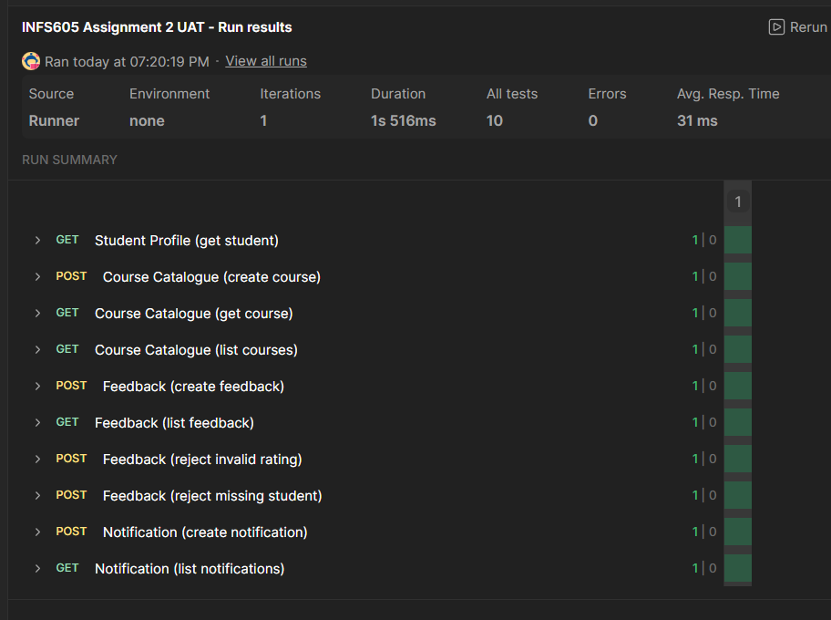
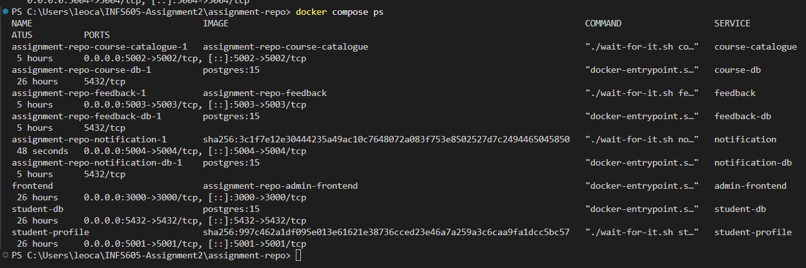

# Student Services Dashboard

This project manages student profiles, courses, feedback, and notifications. Docker Compose runs each service in its own container.

## Services

- **Student Profile** stores student details and attendance. The Admin Portal uses this service.
- **Course Catalogue** stores and returns course information.
- **Feedback** checks that the student and course exist, then stores the feedback.
- **Notification** records a notification when feedback is submitted.
- **Admin Portal** provides a browser interface for Student Profile.

Each backend service has its own PostgreSQL database. Feedback communicates with the other services through their APIs.

## Architecture


## Design notes

Each service owns its own data. Student Profile manages students and attendance, Course Catalogue manages courses, Feedback manages feedback, and Notification records notifications.

Feedback uses HTTP to check that a student and course exist, then asks Notification to record a notification. If Notification is unavailable, Feedback still saves the feedback and returns `notification_recorded: false`. Notifications are recorded by the mock service. The project does not send real emails or retry failed notifications.

## Running locally

Docker Desktop with Docker Compose is required. Postman is needed to run the test collection.

Copy the example settings to a local `.env` file:

```powershell
Copy-Item .env.example .env
```

Keep an existing `.env` file if you already have one. Do not include `.env` in the submission. The `.env.example` file is included as a template.

From the project folder, start the application:

```powershell
docker compose up --build -d
```

Check that the containers are running:

```powershell
docker compose ps
```

Open the Admin Portal at [http://localhost:3000](http://localhost:3000).

The APIs use ports 5001 to 5004. To stop the application, run:

```powershell
docker compose down
```

## API endpoints

### Student Profile, port 5001

- `GET /` returns the service root.
- `GET /students` lists students.
- `GET /students/<student_id>` returns one student.
- `POST /students` creates a student.
- `PUT /students/<student_id>` updates a student's name or email.
- `DELETE /students/<student_id>` deletes a student.
- `POST /students/<student_id>/attendance` adds an attendance record.

### Course Catalogue, port 5002

- `POST /courses` creates a course.
- `GET /courses` lists courses.
- `GET /courses/<course_id>` returns one course.

### Feedback, port 5003

- `POST /feedback` submits feedback.
- `GET /feedback` lists feedback.

Ratings must be from 1 to 5. Feedback is rejected if the student or course does not exist.

### Notification, port 5004

- `POST /notifications` records a notification.
- `GET /notifications` lists notifications.

## Example requests

Create a student:

```http
POST http://localhost:5001/students
Content-Type: application/json

{
  "name": "Test Student",
  "email": "student@example.com"
}
```

Record attendance for an existing student:

```http
POST http://localhost:5001/students/4/attendance
Content-Type: application/json

{
  "date": "2026-10-16",
  "status": "Present"
}
```

Create a course:

```http
POST http://localhost:5002/courses
Content-Type: application/json

{
  "code": "UAT-605",
  "title": "Microservices",
  "description": "Course catalogue test"
}
```

Submit feedback for an existing student and course:

```http
POST http://localhost:5003/feedback
Content-Type: application/json

{
  "student_id": 4,
  "course_id": 1,
  "rating": 5,
  "comment": "Good course"
}
```

A successful request returns `201 Created`. The response includes `notification_recorded: true` when Notification records it. If Notification is unavailable, Feedback still saves the entry and returns `notification_recorded: false`.

Create a notification:

```http
POST http://localhost:5004/notifications
Content-Type: application/json

{
  "feedback_id": 1,
  "recipient": "student@example.com",
  "message": "Feedback received"
}
```

Use IDs that exist in the databases when sending requests directly. You can use the IDs returned by earlier requests.

## Testing with Postman

The collection is at `postman/INFS605 Assignment 2 UAT.postman_collection.json`.

1. Start the application with Docker Compose.
2. In Postman, select **Import** and choose the collection file.
3. Run the **INFS605 Assignment 2 UAT** collection.

The collection creates a course, submits feedback, checks notifications, and tests an invalid rating and a missing student. It completed with **10 passed tests and 0 failed**.

*Figure 1. The Postman collection run showing 10 passed tests and no failures.*



I also stopped Notification and submitted feedback. Feedback was saved with `notification_recorded: false`. I then restarted Notification.

*Figure 2. The Docker Compose services running.*



I restarted the Course Catalogue database container and confirmed that the existing course was still available afterward.

## Project structure

```text
assignment-repo/
├── frontend/
├── student-profile/
├── course-catalogue/
├── feedback/
├── notification/
├── postgres/
├── postman/
├── screenshots/
├── .env.example
├── docker-compose.yml
└── README.md
```