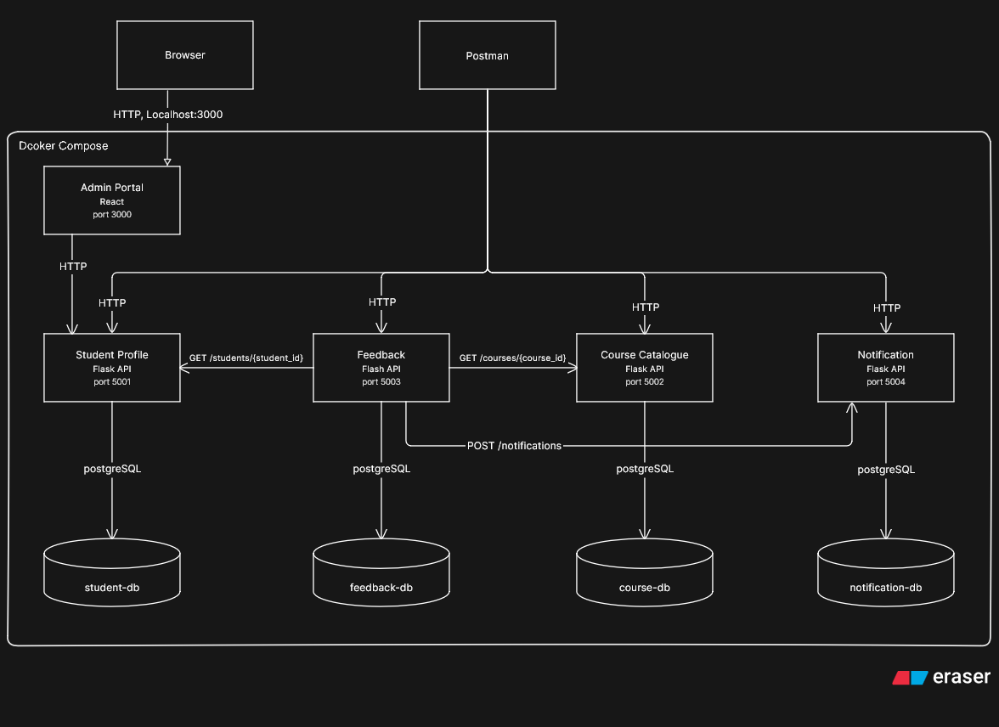

# Student services microservices

A project for my microservices course at AUT, built with Python, Flask, PostgreSQL and Docker. I extended a supplied student management app with course catalogue, feedback and notification services, focusing on service boundaries, API communication and failure handling.

<br>

<p align="center">
  <a href="docs/system-architecture.png"></a>
</p>
<p align="center"><em>Service architecture showing API communication and separate databases.</em></p>

<br>

1. **Separate responsibilities.** Gave each service its own API, database and Docker container. Services exchange data through HTTP rather than reading each other's tables.

2. **Connect the services.** Built a feedback workflow that checks student and course records through their APIs, saves the feedback, then requests a notification. Notifications are stored locally rather than sent as real emails.

3. **Validate requests.** Checked required fields, data types, length limits, ratings and missing records. Used parameterised SQL and HTTP status codes to distinguish invalid input, duplicate courses and unavailable services.

4. **Handle partial failures.** Added timeouts to service calls. Feedback remains saved if the notification service fails, and the response reports that the notification was not recorded.

5. **Test the system.** Wrote Postman acceptance tests and manually checked student updates, attendance, service outages and database persistence after a container restart.

The [Postman collection](tests/acceptance.postman_collection.json) contains request examples and assertions. The recorded run passed [all 10 tests](tests/evidence/postman-uat-results.png), with separate evidence for [failure handling and persistence](tests/evidence/failure-and-persistence.png).

<br>

## Running locally

With Docker Desktop running, copy `.env.example` to `.env`, then start the services:

```sh
docker compose up --build -d
```

Open [localhost:3000](http://localhost:3000) for the student admin portal. Import the [Postman collection](tests/acceptance.postman_collection.json) and run it in order to test all four APIs.

Stop the services with `docker compose down`. This is a local coursework app with no authentication; use sample data only.
